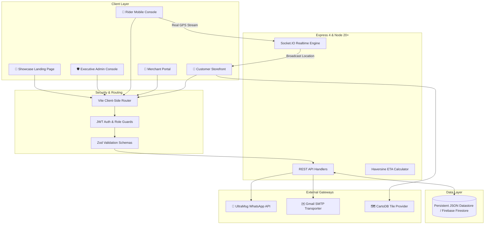

<div align="center">

# 🛍️ ApnaKirana — 10-Minute Hyperlocal Grocery & Kirana Network

[](https://apnakirana-vylc.onrender.com)
[](https://react.dev/)
[](https://nodejs.org/)
[](https://vitejs.dev/)
[](https://expressjs.com/)
[](https://socket.io/)
[](https://ultramsg.com/)
[](https://tailwindcss.com/)
[](https://opensource.org/licenses/MIT)

<p align="center">
  <b>A full-stack, enterprise-grade instant commerce platform modeled after Blinkit, Swiggy Instamart, and Zepto.</b><br>
  Built with real-time GPS telemetry, UltraMsg WhatsApp passwordless authentication, bi-directional Socket.IO order synchronization, government-verified GSTIN/FSSAI onboarding, and a dual-layer executive administration governance portal.
</p>

### 🔗 Live Deployments
**[🌐 Live Customer & Store Platform](https://apnakirana-vylc.onrender.com)** • **[📱 Showcase Landing Page](main/index.html)** • **[🛡️ Executive Admin Portal](https://apnakirana-vylc.onrender.com/admin/login)**

[Explore Branches](https://github.com/bhavyacec25/Apna_kirana/branches) • [Report Issue](https://github.com/bhavyacec25/Apna_kirana/issues) • [Pull Requests](https://github.com/bhavyacec25/Apna_kirana/pulls)

</div>

---

## 📑 Table of Contents
- [Project Overview](#-project-overview)
- [Key Features & Senior-Level Engineering](#-key-features--senior-level-engineering)
- [System Architecture](#-system-architecture)
- [Multi-Tier Security & Governance](#-multi-tier-security--governance)
- [GitFlow Branching Strategy](#-gitflow-branching-strategy)
- [REST API Documentation](#-rest-api-documentation)
- [Quick Start Guide](#-quick-start-guide)
- [Production Deployment](#-production-deployment)
- [Author & Connect](#-author--connect)

---

## 💡 Project Overview

**ApnaKirana** bridges local mom-and-pop grocery stores (*kiranas*) with modern digital instant commerce. Instead of relying on centralized warehouses (dark stores), ApnaKirana routes orders to the nearest neighborhood merchant within 1.5 km, empowering local retailers while providing customers with genuine 10-minute doorstep delivery.

### Core Metrics:
* **Delivery Speed:** Average 10-minute dispatch & doorstep arrival.
* **Authentication:** Passwordless login via WhatsApp UltraMsg Gateway in &lt; 2 seconds.
* **Real-time Telemetry:** 1-second interval GPS coordinates streamed over WebSocket connections.
* **Merchant Quality:** 100% verified GSTIN (15-character alphanumeric format check) & FSSAI food licenses.

---

## 🌟 Key Features & Senior-Level Engineering

### 1. 💬 Automated WhatsApp OTP Authentication (UltraMsg Gateway)
* **Zero SMS Fees:** Direct HTTP integration with UltraMsg WhatsApp API, streaming 6-digit OTP verification codes directly into the user's WhatsApp conversation.
* **Instamart-Style 6-Square UI:** Auto-advancing digit inputs with clipboard auto-paste, backspace navigation, and countdown resend timer.
* **Multi-Gateway Redundancy:** Automatic fallback to Gmail SMTP transporter and Firebase Auth if WhatsApp gateway latency exceeds thresholds.

### 2. 🛵 Blinkit & Zomato Grade Live GPS Delivery Tracking
* **CartoDB Voyager Vector Maps:** High-contrast road geometries rendered with Leaflet without expensive proprietary map API billing.
* **Haversine Geodesic Algorithm:** Dynamic client-side calculation computing remaining distance (`km`), heading angles, and arrival countdown (`~X mins`).
* **Pulsating Radar Sonar Marker:** Animated radar scooter marker indicating vehicle bearing, real-time speed, and delivery partner metadata (**Vikas Kumar**, ★ 4.9).

### 3. 📱 Rider Mobile Geolocation Transmitter (`/rider/:orderId`)
* **Smartphone GPS Watcher:** Delivery partners open their private order URL on mobile browsers to broadcast hardware GPS telemetry via `navigator.geolocation.watchPosition`.
* **Automatic Simulation Override:** Instantly shuts down synthetic server interpolation whenever live smartphone GPS packets stream in.
* **1-Tap Google Maps Directions:** Generates native turn-by-turn routing links directly to the customer's delivery destination.

### 4. 📋 Government Regulatory Compliance (GSTIN & FSSAI)
* **Regex Verification:** Strict validation of 15-character Indian GSTINs (`/^[0-9]{2}[A-Z]{5}[0-9]{4}[A-Z]{1}[1-9A-Z]{1}Z[0-9A-Z]{1}$/`).
* **FSSAI Food License Review:** 14-digit food safety licensing verification and PAN document tracking before a shop is approved to receive orders.

### 5. 🛡️ Bulletproof Dual-Layer Admin Governance & Team Scale-Up
* **Complete Role Separation:** Public `/login` strictly caters to shoppers and merchants. Master admin portal is isolated at `/admin/login`.
* **Server-Side Whitelist Shield:** Requests to `/api/auth/send-otp` with `role: "admin"` are verified against database records. Unauthorized numbers are blocked with `403 Forbidden`.
* **Team Scaling & Member Invites:** Master Admin can authorize and invite new operational admins (Operations Lead, Catalog Manager, Dispute Lead) with instant WhatsApp clearance and safe revocation safeguards.

---

## 🏗️ System Architecture



---

## 📁 Repository Directory Structure

```
apnakirana/
├── backend/
│   ├── data/store.json        ← Persistent datastore (orders, products, users, legal)
│   ├── middleware/            ← JWT auth guards (requireRole), error handling
│   ├── routes/                ← REST APIs (auth, admin, orders, products, reviews)
│   ├── deliverySimulation.js  ← Geodesic coordinate interpolator with GPS override
│   ├── mailer.js              ← Gmail SMTP email OTP transporter
│   ├── realtime.js            ← Socket.IO event broadcaster (order:location, order:status)
│   ├── schemas.js             ← Zod input validation schemas
│   ├── server.js              ← Express & WebSocket server with unified static serving
│   └── sms.js                 ← UltraMsg WhatsApp & multi-channel dispatcher
│
├── frontend/
│   ├── src/
│   │   ├── components/        ← LiveTrackingMap, AdminNavbar, Skeleton loaders
│   │   ├── context/           ← Global AuthContext and state providers
│   │   ├── pages/
│   │   │   ├── customer/      ← Home, Shop, Cart, Checkout, OrderTracking, Wishlist
│   │   │   ├── shopkeeper/    ← Dashboard, Orders, Products, LegalRegistration
│   │   │   ├── admin/         ← AdminDashboard, AdminShops, AdminOrders, AdminUsers
│   │   │   ├── Login.jsx      ← Instamart 6-digit WhatsApp OTP login
│   │   │   └── RiderPortal.jsx← Driver smartphone GPS transmitter
│   │   └── services/          ← API fetchers, location streaming & socket clients
│   └── vite.config.js         ← Vite 5 configuration & dev proxy
│
├── main/                      ← Standalone showcase & landing page for Render
│   ├── index.html             ← Tailwind CSS showcase with narrative & buy CTA
│   ├── server.js              ← Zero-dependency lightweight HTTP server
│   └── package.json           ← Standalone deployment scripts
│
├── render.yaml                ← Render Blueprint Infrastructure-as-Code
└── .node-version              ← Node 20.18 LTS environment pin
```

---

## 🔀 GitFlow Branching Strategy

This repository demonstrates industrial GitFlow practices:

| Branch | Purpose | Status |
| :--- | :--- | :--- |
| **`main`** | Production-ready stable release branch |  |
| **`develop`** | Active integration branch for ongoing staging |  |
| **`feature/whatsapp-otp`** | WhatsApp gateway dispatcher and UltraMsg automation |  |
| **`feature/live-tracking-map`** | CartoDB Voyager map, Haversine ETA calculation & radar marker |  |
| **`feature/rider-portal`** | Dedicated mobile driver console with Google Maps directions |  |
| **`feature/instamart-ui`** | 6-digit individual box OTP and Swiggy Instamart aesthetic |  |

---

## 📡 REST API Reference

| Method | Endpoint | Authorization | Description |
| :--- | :--- | :--- | :--- |
| `POST` | `/api/auth/send-otp` | Public | Generates & dispatches OTP via WhatsApp UltraMsg |
| `POST` | `/api/auth/verify-otp` | Public | Verifies 6-digit OTP code & issues JWT session token |
| `GET` | `/api/orders` | Bearer Token | Retrieves filtered orders for customer or shopkeeper |
| `GET` | `/api/orders/:id/location` | Bearer Token | Returns live coordinates, ETA, speed, and real GPS status |
| `POST` | `/api/orders/:id/rider-location` | Public (Rider) | Streams real mobile GPS coordinates (`lat`, `lng`, `speed`) |
| `POST` | `/api/orders/:id/rider-status` | Public (Rider) | Updates delivery status (`Out for Delivery` &rarr; `Delivered`) |
| `GET` | `/api/admin/admins` | Admin JWT | Retrieves authorized operations administrators |
| `POST` | `/api/admin/admins` | Admin JWT | Authorizes and whitelists a new administrator |
| `DELETE` | `/api/admin/admins/:id` | Admin JWT | Revokes administrative privileges (Master Admin protected) |
| `PATCH` | `/api/admin/shops/:id/legal` | Admin JWT | Approves or rejects GSTIN and FSSAI merchant documents |

---

## 🚀 Quick Start Guide

### Prerequisites
* Node.js v18+ (tested on Node.js v20.18 LTS and v24.17)
* npm or pnpm

### 1. Clone Repository
```bash
git clone https://github.com/bhavyacec25/Apna_kirana.git
cd Apna_kirana
```

### 2. Configure Environment Variables
Create `backend/.env` with your credentials:
```env
PORT=5000
NODE_ENV=development
JWT_SECRET=your_jwt_secret_key
WHATSAPP_INSTANCE_ID=instance196197
WHATSAPP_API_KEY=opf961idpyh3ggx8
GMAIL_USER=your_email@gmail.com
GMAIL_APP_PASSWORD=your_app_password
```

### 3. Run Locally
**Terminal 1 (Backend):**
```bash
cd backend
npm install
npm run dev
```

**Terminal 2 (Frontend):**
```bash
cd frontend
npm install
npm run dev
```

- Customer Store: `http://localhost:5173/login`
- Executive Admin Portal: `http://localhost:5173/admin/login`

---

## ☁️ Production Deployment (Render)

This repository includes a native [`render.yaml`](render.yaml) Blueprint:
1. Go to [dashboard.render.com](https://dashboard.render.com/) and click **New +** ➔ **Blueprint**.
2. Connect `bhavyacec25/Apna_kirana`.
3. Render automatically provisions the unified service with Node 20, builds the frontend, and serves both API and UI on a single live URL:
   👉 **`https://apnakirana-vylc.onrender.com`**

---

## 👨‍💻 Author & Contact

**Bhavya Chhajer**  
Full-Stack Software Engineer · Specializing in React, Node.js & Real-Time Distributed Systems

* **GitHub:** [@bhavyacec25](https://github.com/bhavyacec25)  
* **Email:** [chhajerbhavya30@gmail.com](mailto:chhajerbhavya30@gmail.com)  
* **LinkedIn:** [linkedin.com/in/bhavyachhajer](https://linkedin.com) *(Update with your direct URL)*

---

## 📄 License
This project is open-source and licensed under the [MIT License](LICENSE).

---

## 🌟 Key Highlights & Architecture

### 1. 💬 Automated WhatsApp OTP Authentication
* **Zero Telecom Cost:** Eliminates cellular SMS DLT fees by streaming 6-digit OTP verification codes directly to the customer's WhatsApp chat via the UltraMsg Gateway.
* **Instamart-Style 6-Box Input:** Auto-advancing OTP input boxes with backspace navigation, auto-focus, and clipboard paste support.
* **Multi-Channel Fallback:** Supports Gmail SMTP email verification and Firebase Authentication.

### 2. 🛵 Blinkit & Zomato Style Live Delivery Tracking
* **CartoDB Voyager Vector Map:** High-contrast, clean road geometry without proprietary Google Maps billing or API token limitations.
* **Live Dynamic ETA & Distance:** Uses the Haversine geodesic algorithm to dynamically compute exact remaining distance (`km`) and real-time arrival estimates (`~X mins`).
* **Pulsating Radar Scooter:** High-visibility delivery partner scooter marker with animated sonar radar halo and orientation heading.
* **Delivery Partner Profile Card:** Displays assigned driver details (**Vikas Kumar**, ★ 4.9, Hero Splendor PB 10 EK 4589, Verified Safety Check) with direct 1-tap phone dialer and quick delivery instructions presets.

### 3. 📱 Delivery Partner Mobile Console (`/rider/:orderId`)
* **Real Mobile Phone GPS Streaming:** Riders open their order URL on any mobile browser and tap **"START SHARING REAL PHONE GPS"** (`navigator.geolocation.watchPosition` with high accuracy).
* **Automatic Simulation Override:** Instantly shuts down synthetic server interpolation whenever real smartphone GPS packets stream in.
* **1-Tap Google Maps Navigation:** Generates native turn-by-turn driving directions to the customer's doorstep in Google Maps.
* **One-Touch Status Control:** Allows riders to toggle delivery states (`Out for Delivery` &rarr; `Delivered`).

---

## 🏗️ System Architecture

```
apnakirana/
├── backend/
│   ├── routes/              ← REST API endpoints (auth, orders, products, admin, reviews)
│   ├── middleware/          ← JWT authentication, role guards & centralized error handling
│   ├── deliverySimulation.js← Real-time vehicle simulation with real GPS override
│   ├── realtime.js          ← Socket.IO event broadcaster (order:location, order:status)
│   ├── sms.js               ← WhatsApp (UltraMsg) & multi-gateway dispatcher
│   ├── mailer.js            ← Gmail SMTP email OTP transporter
│   └── server.js            ← Express HTTP & WebSocket server entrypoint
│
└── frontend/
    ├── src/
    │   ├── components/      ← Reusable UI (LiveTrackingMap, Navbar, Cards, Badges)
    │   ├── context/         ← Global AuthContext and state providers
    │   ├── pages/
    │   │   ├── customer/    ← Home, Shop, Cart, Checkout, OrderTracking, Wishlist
    │   │   ├── shopkeeper/  ← Dashboard, Orders, Products, Legal/GST Registration
    │   │   ├── admin/       ← Admin Dashboard, Shops, Users, System Orders
    │   │   ├── Login.jsx    ← Swiggy Instamart-style WhatsApp OTP login
    │   │   └── RiderPortal.jsx ← Mobile delivery partner GPS transmitter
    │   └── services/        ← API fetchers, location streaming & socket clients
```

---

## 🔀 Git Branching Strategy & GitFlow

This repository follows standard industrial GitFlow conventions:

| Branch | Description | Status |
| :--- | :--- | :--- |
| **`main`** | Production-ready stable release branch |  |
| **`develop`** | Active integration branch for ongoing staging |  |
| **`feature/whatsapp-otp`** | WhatsApp gateway dispatcher and UltraMsg automation |  |
| **`feature/live-tracking-map`** | CartoDB Voyager map, Haversine ETA calculation & radar marker |  |
| **`feature/rider-portal`** | Dedicated mobile driver console with Google Maps directions |  |
| **`feature/instamart-ui`** | 6-digit individual box OTP and Swiggy Instamart aesthetic |  |

---

## 🚀 Quick Start Guide

### Prerequisites
* Node.js v18+ (tested on Node.js v24.17.0)
* npm or pnpm

### 1. Clone Repository
```bash
git clone https://github.com/bhavyacec25/Apna_kirana.git
cd Apna_kirana
```

### 2. Configure Backend Environment
Copy the environment template in `backend/.env.example` to `backend/.env` and update your credentials:
```env
PORT=5000
GMAIL_USER=your_email@gmail.com
GMAIL_APP_PASSWORD=your_app_password
WHATSAPP_INSTANCE_ID=your_instance_id
WHATSAPP_API_KEY=your_token
JWT_SECRET=apnakirana_secret_key
```

### 3. Start Backend Server
```bash
cd backend
npm install
npm run dev
```
> Server runs on `http://localhost:5000` with WebSocket attached.

### 4. Start Frontend Client
```bash
cd frontend
npm install
npm run dev
```
> Client opens on `http://localhost:5173`.

---

## 📡 REST API Reference

| Method | Endpoint | Access | Description |
| :--- | :--- | :--- | :--- |
| `POST` | `/api/auth/send-otp` | Public | Generates & dispatches OTP via WhatsApp / Gmail |
| `POST` | `/api/auth/verify-otp` | Public | Verifies 6-digit OTP code & issues JWT session |
| `GET` | `/api/orders` | Auth | Retrieves user-filtered or shop-filtered order history |
| `GET` | `/api/orders/:id/location` | Customer | Returns live coordinates, ETA, speed, and real GPS status |
| `GET` | `/api/orders/:id/rider` | Public | Provides delivery driver console data |
| `POST` | `/api/orders/:id/rider-location` | Rider | Streams real mobile GPS coordinates (`lat`, `lng`, `speed`) |
| `POST` | `/api/orders/:id/rider-status` | Rider | Updates order status (`Out for Delivery`, `Delivered`) |

---

## 👨‍💻 Author

**Bhavya Chhajer**  
* GitHub: [@bhavyacec25](https://github.com/bhavyacec25)  
* Email: [chhajerbhavya30@gmail.com](mailto:chhajerbhavya30@gmail.com)

---

## 📄 License
This project is open-source under the [MIT License](LICENSE).
